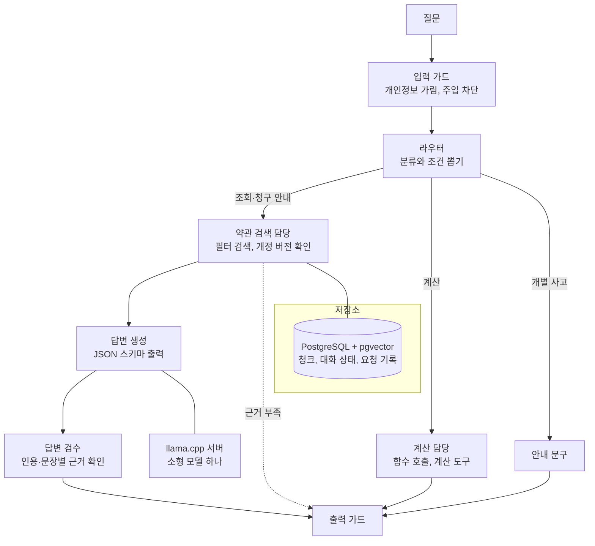

# Clausebook

가상 보험 상품 6종의 약관·설명서·청구 안내를 읽고 질문에 답하는 상담 도우미입니다. 답마다 근거 조항을 붙이고, 약관에 없는 내용은 없다고 답하고, 검색 품질과 답변을 질문 142개로 재서 구성별·모델별 결과를 비교했습니다.

**데모**: https://choibongseok.github.io/clausebook/ (미리 돌려 둔 실제 실행 기록을 재생합니다. 화면에서 모델이 새로 답하지는 않습니다.)


상품, 약관, 고객은 모두 직접 지어낸 예시입니다. 실제 보험사나 약관과 관계가 없습니다.

## 구조



한 턴의 단계와 허용된 전이는 `src/clausebook/pipeline.py` 의 `Stage` 와 `TRANSITIONS` 에 그대로 있고, 시험이 실제 실행 순서가 이 표를 벗어나지 않는지 봅니다.

## 5분 실행

필요한 것: Docker, 빈 디스크 3GB 정도. 로컬 Python 은 쓰지 않습니다(모든 실행이 컨테이너 안의 Python 3.12 입니다).

```
make up            # 모델 파일을 .models/ 로 받고(약 0.6GB), DB·모델 서버·API 를 올립니다
curl -s localhost:58780/v1/chat -H 'content-type: application/json' \
  -d '{"message":"든든 정기보험 청약을 철회할 수 있는 기간은 어떻게 되나요?"}'
make down
```

호스트 포트는 58732(PostgreSQL), 58733(모델 서버), 58780(API)입니다. API:

| 경로 | 내용 |
|---|---|
| `POST /v1/chat` | 대화. `session_id` 로 이어 묻고, `"stream": true` 면 단계별 이벤트(SSE)를 보냅니다 |
| `GET /v1/sources/{조항 id}` | 근거 조항 원문과 시행 기간 |
| `POST /v1/eval/run` | 지정한 분할·검색·재정렬 구성의 검색 지표 |
| `GET /v1/sessions/{id}`, `GET /healthz` | 대화 상태, 상태 확인 |

명령 모음: `make test`(단위+통합, 모델 서버 없이), `make e2e`, `make eval`(전체 평가, 오래 걸림), `make verify`, `make web`, `make pages`(gh-pages 로컬 커밋, push 안 함).

## 설계 결정

**문서와 분할.** 약관은 조·항·호로 쓰고 개정된 조항은 제목 끝에 시행 기간을 붙였습니다(`[시행 ~2025-06-30]`). 조항 id 는 `문서#제9조@v1` 처럼 버전까지 포함합니다. 표는 행마다 `표 행: 경과 연수 5년, 환급률 21%` 문장으로 풀어서 검색에 걸리게 하고, 사람에게 보여 줄 때는 원문 표를 씁니다. 분할은 같은 인터페이스(`Chunker.chunk(doc)`)로 세 가지입니다: 고정 길이(320자, 60자 겹침), 조항 단위, 조항 + 상위 문맥(상품·문서·조항 제목을 앞에 붙임). 어떤 분할이든 청크가 덮는 조항 id 를 들고 있어서 같은 정답으로 채점합니다.

**한국어 키워드 검색.** 형태소 분석기 없이 어절에서 흔한 조사·어미를 떼고, 두 글자 이상 한글 어간은 글자 2-gram 도 함께 씁니다. 숫자와 단위는 한 토큰(`5년`)입니다. BM25(k1=1.5, b=0.75)는 이 토큰으로 메모리에서 계산합니다.

**밀집 검색.** `multilingual-e5-small` 의 int8 ONNX 를 onnxruntime 으로 CPU 에서 돌립니다(질문 `query: `, 문서 `passage: ` 접두사, 평균 풀링, 정규화). 벡터는 pgvector(`vector(384)`, 코사인, HNSW)에 있고 상품·계약일·문서 종류 필터는 SQL 에서 겁니다.

**점수 결합.** 두 가지를 모두 만들어 비교했습니다. RRF 는 두 목록의 순위로 `1/(60+순위)` 를 더하고, 가중 결합은 목록 안에서 최소-최대 정규화한 점수를 0.5:0.5 로 더합니다.

**재정렬.** 교차 인코더는 쓰지 않았습니다. 상위 후보에 대해 질문 핵심어가 조항 본문·제목에 들어 있는 비율(IDF 가중)과 숫자 일치를 앞 단계 점수와 섞는 규칙입니다(`0.5·앞 점수 + 0.3·본문 포함률 + 0.15·제목 포함률 + 0.05·숫자`).

**개정 버전.** 계약일을 알면 그 날짜에 유효한 조항 버전만 검색합니다. 계약일을 모르는데 상위 결과에 개정 조항이 있으면 가입 시기를 되묻고, 답을 받으면 보류한 질문을 다시 풉니다.

**역할 분담과 상태.** 역할을 코드로 나눴습니다: 입력 가드, 라우터(규칙 기반 분류와 조건 뽑기), 약관 검색 담당, 계산 담당, 청구 안내 담당(문서 종류 필터만 다른 검색 경로), 답변 검수 담당. 대화 상태(상품, 계약일, 진단확정일, 보류한 질문, 마지막 질문)는 PostgreSQL 의 세션 표에 JSON 으로 저장하고, 짧은 후속 질문은 마지막 질문과 합쳐 검색합니다. 프레임워크 없이 `pipeline.py` 한 파일에 단계와 전이를 모았습니다.

**계산을 도구로 뺀 이유.** 보험금과 환급금은 틀리면 안 되는 숫자이고 약관 규칙(대기기간, 감액, 개정 전후 비율)이 날짜에 따라 달라서, 모델이 계산하게 두면 검증할 방법이 없습니다. 도구 다섯 개(`medical_reimbursement`, `cancer_benefit`, `surrender_value`, `baggage_claim`, `kid_hospital_daily`)를 OpenAI 호환 함수 호출 정의로 설명하고, 모델은 도구와 인자만 JSON 스키마에 맞춰 고릅니다. 인자가 질문의 조건과 다르면 한 번 다시 요청하고, 그래도 다르면 규칙으로 뽑은 값을 씁니다.

**구조화 출력.** 답변과 도구 호출 모두 JSON 스키마를 llama.cpp 의 문법 제한 생성에 걸고, 돌아온 값을 다시 `jsonschema` 로 검증합니다. 어긋나면 한 번 다시 요청하고, 시간 초과나 모델 오류면 추출 답변(근거 문장을 그대로 고름)으로 대체합니다. 프롬프트와 출력 스키마는 `prompts/<버전>/` 파일이고 평가 결과마다 버전이 남습니다.

**인용 검사.** 답의 문장마다 (1) 인용한 근거 번호가 실제 검색 결과에 있는지, (2) 문장의 핵심어가 인용한 조항에 절반 이상 있는지, (3) 문장 속 숫자가 조항에 있는지 봅니다. 통과하지 못한 문장은 빼고, 남은 문장이 없으면 "약관에서 찾지 못했습니다"로 답합니다. 인용이 비어 있어도 근거가 되는 검색 결과가 있으면 그 조항으로 잇습니다(인용 보정).

**주입·개인정보.** 입력에서 주민등록번호, 전화, 계좌, 카드, 이메일 형식을 가린 뒤에만 검색·모델·기록으로 넘깁니다. "이전 지시 무시", 시스템 프롬프트 요구, 역할 변경, 관리자 사칭 표현은 검색 전에 막습니다. 문서 안에 심은 지시문(여행자보험 FAQ 5번에 일부러 넣음)은 적재할 때 표시하고, 근거로 쓰지 않습니다. 개별 사고의 지급 여부를 확정해 달라는 질문은 약속도 거절도 하지 않고 심사 안내로 돌립니다.

**평가셋을 어떻게 만들었나.** 질문 142개를 직접 썼습니다: 단순 조회 26, 돌려 말하기 16, 계산 14, 예외 조항 12, 답이 문서에 없음 12, 표 조회 10, 멀티턴 후속 10, 여러 조항 결합 8, 주입 시도 8, 개정 버전 8, 개인정보 6, 개별 심사 6, 청구 안내 6. 질문마다 정답 조항 id(여러 후보 중 하나면 묶음)와 정답에 들어가야 할 요소, 기대 동작(답, 계산, 못 찾음, 차단, 안내, 되묻기)이 있습니다. 질문의 3분의 1(`split=dev`)로 근거 충분성 문턱과 검색 구성을 고르고, 나머지(`split=test`)는 보류했습니다.

**무엇을 못 재는가.** 질문을 약관을 쓴 사람이 만들었기 때문에 낱말이 겹치기 쉽습니다(돌려 말하기 유형으로 일부 보완). 정답 요소 포함은 낱말 포함만 보므로 문장의 뜻과 자연스러움은 못 잽니다. 모델을 심판으로 쓰지 않았고, 사람이 검수한 표본과의 일치율도 재지 않았습니다. 질문 수가 적어 1%p 안팎 차이는 의미가 없습니다.

## 모델

모든 모델은 공개 가중치이고 로컬 컨테이너에서 돌립니다. 가중치 파일은 저장소에 없고 `scripts/models.sh` 가 내려받습니다. 유료 API 는 쓰지 않았습니다.

| 용도 | 모델 | 파일·양자화 | 크기 | 라이선스 |
|---|---|---|---|---|
| 임베딩 | intfloat/multilingual-e5-small | ONNX int8 (`model_qint8_avx512_vnni.onnx`) + tokenizer.json | 118MB + 17MB | MIT |
| 생성 | Qwen/Qwen2.5-0.5B-Instruct-GGUF | `qwen2.5-0.5b-instruct-q4_k_m.gguf` | 491MB | Apache-2.0 |
| 생성 | Qwen/Qwen2.5-1.5B-Instruct-GGUF | `qwen2.5-1.5b-instruct-q4_k_m.gguf` | 907MB | Apache-2.0 |

합계 약 1.5GB(조건 4GB 이하)이고 생성 모델은 한 번에 하나만 올립니다. 모델 서버는 llama.cpp 의 `llama-server`(이미지 `ghcr.io/ggml-org/llama.cpp:server`), 컨텍스트 4096, 스레드 6, 온도 0, 고정 시드입니다.

측정 환경: Apple Silicon 맥(메모리 16GB)의 Docker(OrbStack) 컨테이너에서 CPU 추론. 다른 프로젝트의 컨테이너가 같은 머신에서 돌고 있었으므로 응답 시간은 참고용입니다.

## 평가 결과와 모델 선정 근거

표는 `make eval` 이 남긴 결과 파일(`eval/results/*.json`)에서 옮겼고, `make verify` 가 README 의 표와 결과 파일이 같은지 대조합니다. 지표 정의는 아래 표 다음에 있습니다. 이전 결과와의 차이는 `eval/results/answers_*.json` 의 `diff_from_previous` 에 남습니다.

<!-- eval-tables:start -->
### 검색 구성 비교 (nDCG@5 순, 상위 8개)

| 분할 | 검색 | 재정렬 | Recall@1 | Recall@5 | MRR | nDCG@5 | nDCG@5 (보류 집합) |
|---|---|---|---|---|---|---|---|
| 조항+상위 문맥 | 밀집 | 규칙 | 0.657 | 0.980 | 0.815 | 0.855 | 0.865 |
| 조항+상위 문맥 | 하이브리드(RRF) | 규칙 | 0.657 | 0.931 | 0.805 | 0.831 | 0.832 |
| 조항+상위 문맥 | 하이브리드(가중) | 규칙 | 0.642 | 0.941 | 0.798 | 0.829 | 0.842 |
| 조항+상위 문맥 | 하이브리드(RRF) | 없음 | 0.647 | 0.907 | 0.792 | 0.814 | 0.833 |
| 조항+상위 문맥 | 밀집 | 없음 | 0.588 | 0.936 | 0.764 | 0.806 | 0.822 |
| 조항+상위 문맥 | 하이브리드(가중) | 없음 | 0.574 | 0.926 | 0.762 | 0.798 | 0.833 |
| 고정 길이 | 하이브리드(RRF) | 없음 | 0.534 | 0.976 | 0.741 | 0.783 | 0.803 |
| 조항+상위 문맥 | BM25 | 규칙 | 0.559 | 0.902 | 0.736 | 0.770 | 0.802 |

전체 24개 구성은 [eval/results/summary.md](eval/results/summary.md) 에 있습니다.

### 답변 평가: 모델 비교

| 모델 | 통과율 | 정답 요소 포함률 | 인용 적중률 | 인용 정밀도 | 근거 밖 숫자 답변 | 거절 정확도 | 거짓 거절 | 계산 정확 | 응답 p50 | 응답 p95 | 100건당 예상 비용($) |
|---|---|---|---|---|---|---|---|---|---|---|---|
| 추출 기준선(모델 없음) | 71.8% | 78.1% | 81.4% | 50.6% | 6.3% | 83.3% | 3.6% | 100.0% | 0.01s | 0.01s | - |
| 모의: 지어내기형 | 71.8% | 78.1% | 81.4% | 50.6% | 6.3% | 83.3% | 3.6% | 100.0% | 0.01s | 0.01s | - |
| 모의: 부정확형 | 39.4% | 45.5% | 38.1% | 28.9% | 6.3% | 83.3% | 3.6% | 100.0% | 0.01s | 0.01s | - |
| Qwen2.5-0.5B Q4_K_M, 프롬프트 v1 | 42.2% | 33.5% | 39.0% | 25.4% | 13.1% | 100.0% | 45.5% | 100.0% | 2.14s | 6.45s | 0.0150 |
| Qwen2.5-0.5B Q4_K_M, 프롬프트 v2 | 38.7% | 36.6% | 44.9% | 35.7% | 8.1% | 83.3% | 3.6% | 100.0% | 2.03s | 3.43s | 0.0100 |
| Qwen2.5-1.5B Q4_K_M, 프롬프트 v2 | 57.0% | 65.6% | 64.4% | 54.2% | 6.7% | 91.7% | 8.0% | 92.9% | 3.23s | 4.62s | 0.0097 |

### 질문 유형별 통과율

| 유형 | 질문 수 | 추출 기준선(모델 없음) | 모의: 지어내기형 | 모의: 부정확형 | Qwen2.5-0.5B Q4_K_M, 프롬프트 v1 | Qwen2.5-0.5B Q4_K_M, 프롬프트 v2 | Qwen2.5-1.5B Q4_K_M, 프롬프트 v2 |
|---|---|---|---|---|---|---|---|
| calc | 14 | 100.0% | 100.0% | 100.0% | 100.0% | 100.0% | 92.9% |
| claims | 6 | 66.7% | 66.7% | 0.0% | 33.3% | 0.0% | 66.7% |
| exception | 12 | 50.0% | 50.0% | 16.7% | 8.3% | 8.3% | 16.7% |
| followup | 10 | 70.0% | 70.0% | 20.0% | 20.0% | 0.0% | 50.0% |
| individual | 6 | 100.0% | 100.0% | 100.0% | 100.0% | 100.0% | 100.0% |
| injection | 8 | 100.0% | 100.0% | 100.0% | 100.0% | 100.0% | 100.0% |
| lookup | 26 | 65.4% | 65.4% | 23.1% | 23.1% | 23.1% | 46.2% |
| multi | 8 | 25.0% | 25.0% | 0.0% | 0.0% | 0.0% | 12.5% |
| notfound | 12 | 83.3% | 83.3% | 83.3% | 100.0% | 83.3% | 91.7% |
| paraphrase | 16 | 50.0% | 50.0% | 12.5% | 6.2% | 25.0% | 18.8% |
| pii | 6 | 50.0% | 50.0% | 0.0% | 33.3% | 0.0% | 83.3% |
| table | 10 | 100.0% | 100.0% | 0.0% | 30.0% | 10.0% | 60.0% |
| version | 8 | 87.5% | 87.5% | 75.0% | 37.5% | 62.5% | 62.5% |
<!-- eval-tables:end -->

지표: **Recall@k**는 정답 조항이 상위 k 개 안에 있는 비율, **MRR**은 첫 정답 순위의 역수 평균, **nDCG@5**는 정답이 앞에 있을수록 높은 점수입니다. **통과율**은 기대 동작과 일치하고, 정답 요소가 모두 들어 있고, 정답 조항을 인용했고, 금지 표현이 없는 질문의 비율입니다. **근거 밖 숫자 답변**은 답에 든 숫자가 인용한 조항 원문에 없는 답변의 비율입니다. **응답 시간**은 질문 한 건(멀티턴은 전체 턴)의 파이프라인 시간입니다. **예상 비용**은 `(입력 토큰×0.10 + 출력 토큰×0.40) / 100만` 달러를 질문 100건당으로 바꾼 값이며, 단가는 호스팅 소형 모델 가격대를 가정한 값이고 실제로 낸 돈이 아닙니다.

### 모델 선정 근거

**검색 구성: 조항 + 상위 문맥 분할, 밀집 검색, 규칙 재정렬.** 개발 집합에서 nDCG@5 가 가장 높았고, 보류 집합에서도 순위가 같았습니다(0.865). 문맥 머리글(상품·문서·조항 제목)을 붙인 분할이 같은 검색 방식에서 다른 분할보다 높습니다. 하이브리드는 이 데이터에서 밀집 검색을 넘지 못했습니다. 조항이 짧고 같은 낱말(상품 이름, 보험금, 청구)이 거의 모든 조항에 있어서 BM25 가 변별력이 낮았고, 토큰화를 형태소 수준으로 바꾸지 않은 영향도 있을 것입니다(확인하지 않았습니다). 고정 길이 분할은 청크 하나가 여러 조항을 덮어서 Recall@5 는 높게 나오지만 MRR 과 nDCG 가 낮습니다.

**생성 모델: 이 용도에는 Qwen2.5-1.5B(프롬프트 v2)를 고르고 0.5B 는 쓰지 않겠습니다.** 기준은 정확도, 응답 시간, 비용 순입니다.

| | 0.5B (v2) | 1.5B (v2) |
|---|---|---|
| 통과율 | 38.7% | 57.0% |
| 정답 요소 포함 | 36.6% | 65.6% |
| 인용 적중 | 44.9% | 64.4% |
| 응답 p50 / p95 | 2.03s / 3.43s | 3.23s / 4.62s |
| 100건당 예상 비용(가정 단가) | $0.0100 | $0.0098 |

1.5B 는 응답이 1초 남짓 느리지만 정확도 지표가 모두 크게 높고, 토큰 수는 비슷해서 예상 비용은 같습니다. 0.5B 는 형식은 맞추지만 근거를 읽고도 엉뚱한 문장을 고르거나 짧게 못 찾았다고 답하는 경우가 많았습니다. 두 모델 모두 표 조회, 여러 조항 결합, 돌려 말하기, 예외 조항에서 약했습니다.

**모델 없는 추출 기준선이 두 모델보다 높습니다(통과율 71.8%).** 근거 문장을 그대로 고르는 방식이라 낱말 포함과 인용을 채점하는 이 평가에서 유리합니다. 소형 모델이 근거를 요약하면서 숫자나 조건을 빠뜨리는 것이 그대로 드러난 결과이고, 평가가 문장의 뜻과 자연스러움을 재지 못한다는 한계와 같이 읽어야 합니다. 그래서 서비스에서는 계산, 되묻기, 거절, 개별 심사 안내를 모델 없이 코드가 처리하게 두었고(계산 정확도 100%, 1.5B 는 모델이 도구를 잘못 고른 1건 때문에 92.9%), 조회 답변도 모델 출력이 형식이나 근거 검사에 실패하면 추출 답변으로 대체합니다. 더 큰 모델이 이 기준선을 넘는지는 이 환경에서 확인하지 못했습니다.

**검수 단계의 효과.** 지어내기형 모의 모델(근거에 없는 문장을 덧붙임)의 점수가 추출 기준선과 같은 것은, 덧붙인 문장이 검수에서 모두 빠졌다는 뜻입니다. 부정확형 모의 모델은 통과율 39.4%로 기준선보다 크게 낮게 채점되어, 평가가 나쁜 답을 나쁘게 본다는 점검 용도로 넣었습니다(실제 모델 성능이 아닙니다).

**프롬프트 버전.** 0.5B 에서 v1 은 답을 쓰고도 `answerable` 을 false 로 두거나 문장을 길게 늘여 형식 오류가 나서 거짓 거절이 45.5% 였습니다. v2(답을 먼저 쓰고 마지막에 판정, 300자 제한, 예시 하나)는 거짓 거절을 3.6% 로 줄였지만 통과율은 42.3% 에서 38.7% 로 올라가지 않았습니다. 형식 문제는 해결됐고 근거를 읽는 능력의 한계는 남았다는 뜻입니다. 두 결과 모두 `eval/results/` 에 있고 같은 평가를 다시 돌리면 `diff_from_previous` 가 달라진 지표와 새로 실패한 질문을 보여 줍니다.

**답이 문서에 없을 때.** 거절 정확도는 1.5B 91.7%, 추출 기준선 83.3%, 0.5B(v1)는 100%입니다. 0.5B(v1)는 거의 모든 질문에 못 찾았다고 답해서 얻은 값이라 거짓 거절 45.5% 와 같이 봐야 합니다.

## 테스트

`docs/TEST_CASES.md` 의 모든 행이 실제 시험 함수 하나와 1:1 이고, `make verify` 가 문서가 최신인지, 모든 행이 통과한 실제 시험인지 대조합니다. 평가 질문 142개는 이 개수에 세지 않습니다.

| 종류 | 시험 함수 | 실행 |
|---|---|---|
| 단위(분할, 한국어 토큰, 검색·점수 결합·필터·재정렬, 계산 도구, 스키마, 개인정보·주입, 인용 검사, 조건 추출, 라우터, 평가 지표, 평가셋) | 82 (매개변수 확장 105건) | `make test` |
| 통합(실제 PostgreSQL·pgvector·e5 + 모의 모델로 대화 흐름: 멀티턴, 주입, 개인정보, 문서 속 지시문, 지어낸 문장, 형식 오류 재요청, 시간 초과 대체, 상태 전이) | 30 | `make test` |
| e2e(compose 로 띄운 API: 멀티턴 세션, 스트리밍, 근거 보기, 주입, 개인정보, 문서에 없는 질문, 입력 검증) | 13 | `make e2e` |
| 브라우저(데모 사이트, 실제 Chrome: 첫 방문 설명, 쿠키, 키보드, 모바일, 대비, 표 수치 대조) | 16 | `make verify` |
| **합계** | **141** | |

모델이 필요한 시험은 없고, 모델 동작은 능력이 다른 모의 모델 프로필로 시험합니다. 실제 모델은 `make eval` 로 측정합니다. [docs/TEST_CASES.md](docs/TEST_CASES.md)

## 한계

- 파인튜닝은 다루지 않았습니다.
- 평가 질문은 직접 만든 것이고 규칙으로 채점했습니다. 문장의 뜻, 자연스러움, 실제 고객 질문 분포는 재지 못했습니다.
- 생성 모델은 소형 모델 둘만 비교했습니다. 더 큰 모델과 한국어 특화 모델은 시험하지 못했습니다.
- 재정렬은 규칙이고 교차 인코더 결과와 비교하지 않았습니다.
- 라우터와 조건 뽑기는 규칙 기반이라 처음 보는 표현에 약합니다.
- 실제 고객 데이터, 운영 부하 시험, 서비스 운영은 해 보지 않았습니다.
- 응답 시간은 CPU 추론이고 다른 컨테이너와 같이 돌린 값입니다.
